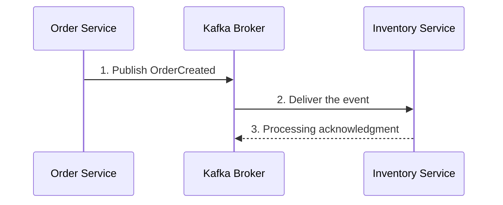

# Kafka OrderCreated Event — Sequence Diagram

This Mermaid diagram is the source of truth for participants, roles, and the three
message labels in the `kafka-sequence` HyperFrames video. Edit this file to
change the diagram; the existing 12-second GSAP animation timing remains in HTML.

## Narrated sequence

1. **Producer:** The order service prepares an `OrderCreated` event.
2. **Publish:** The producer publishes the event to the `orders` Kafka topic.
3. **Consume:** The inventory service consumes the event and updates inventory.
4. **Complete:** Processing finishes. In real Kafka flows, acknowledgments and
   offset commits depend on the consumer configuration and processing design.

> The Markdown controls the diagram labels. The HTML composition retains the
> 12-second timeline, animation, and narration callout text. The server compiles
> this Markdown into HTML before invoking HyperFrames.
