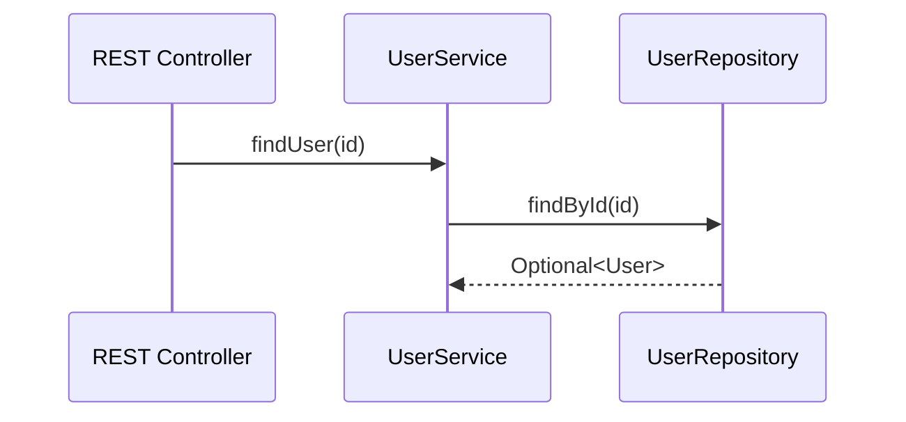

# Java Source Code Review

## Source File
`src/main/java/app/service/UserService.java`

## Source Code

```java
public User findUser(Long id) {
    Optional<User> user = repository.findById(id);
    return user.orElse(null);
}
```

## Review Findings

### Inspect method contract [lines: 1]
First check the method signature and what the callers expect as its return value.

### Analyze repository lookup [lines: 2]
The repository returns Optional, which can represent an absent user.

### Check nullable result [lines: 3]
The method may return null. This is a review candidate, not necessarily a confirmed bug.

### Validate calling code [lines: 3-4]
Verify how callers handle absence. Choose Optional, a domain exception or explicit null handling to match the API contract.

## Sequence Diagram


